# Lab 01: Forensic Validation and a Suspected Data Leak

**Course:** CYS 405 Advanced Digital Forensics | **Tools:** WinHex, Autopsy | **Evidence:** InChap09.dd

## Objective
Validate data with a hex editor, see how bit-level changes hide information, then investigate a disk image for evidence of a suspected leak of confidential project files.

## Part A: Validating with a Hex Editor

### 1. Computing an MD5 Hash
A Word document was opened in WinHex and hashed with MD5 (128-bit), producing `9E28D682BBF0C8D34286DDEECC15CBD3`. Recording this value lets any later change to the file be detected.

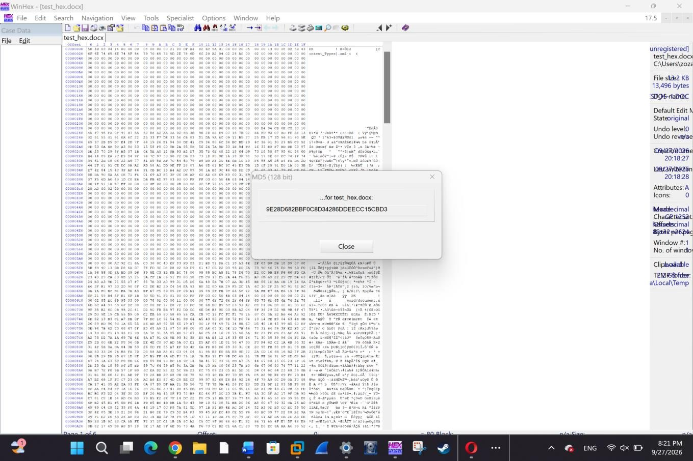

### 2. Bit Shifting
A text file was shifted left by 1 bit using **Modify Data**. The readable text turned into unreadable bytes because every byte value changed. A right shift by 1 bit was then applied to reverse the change, and the result was compared with the original.

| Original | Left shift selected | After the shift |
|---|---|---|
| 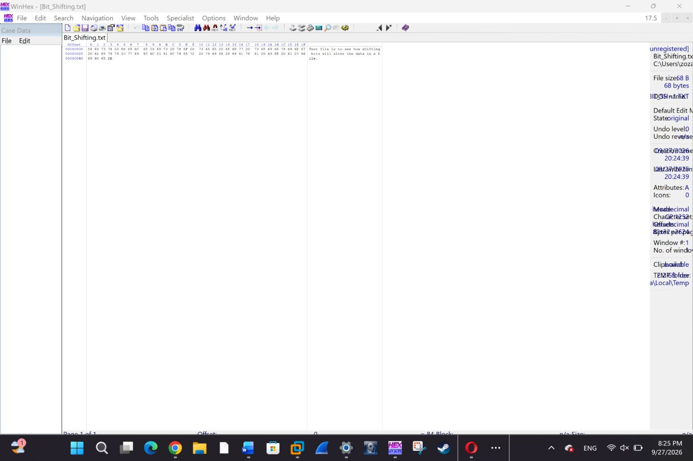 |  | 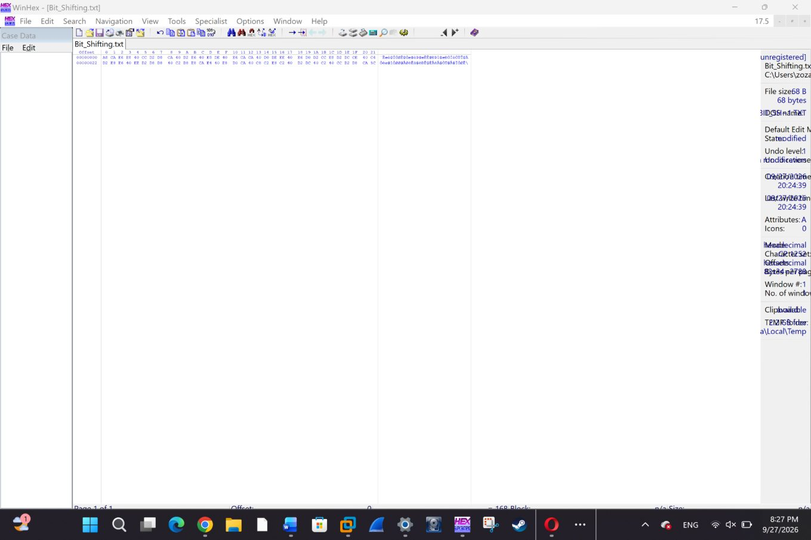 |

### 3. Circular Rotation (Hands-on Project 9-1)
A file containing a sensitive message was obfuscated with **circular left rotation**. ASCII data returns to its original readable form after eight rotations in total, which shows how a suspect could hide text with a simple, reversible transform.

| Rotation selected | After rotation |
|---|---|
| 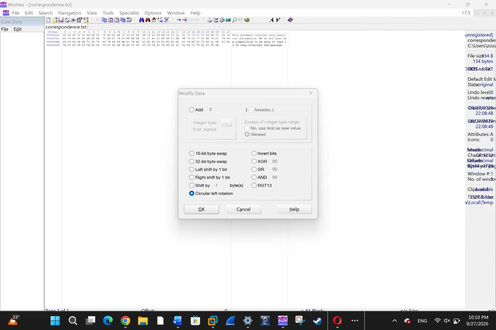 | 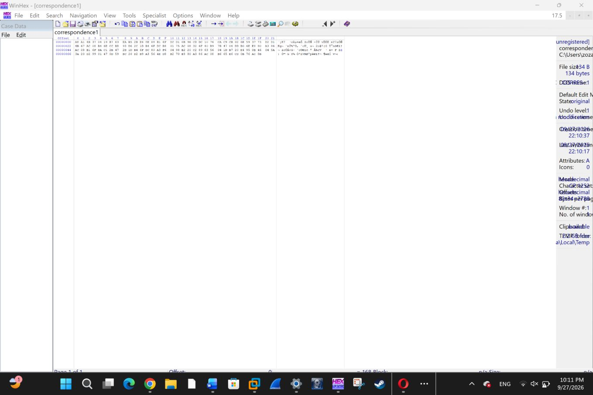 |

## Part B: Investigating a Suspected Data Leak

### Processing and Reducing the Evidence
The disk image was processed in Autopsy, which extracted e-mail, web history, EXIF metadata, extension mismatches, and suspected user content. A **known-file hash set** was imported so that standard system files could be excluded from manual review.

| Autopsy case | Hash set import |
|---|---|
| 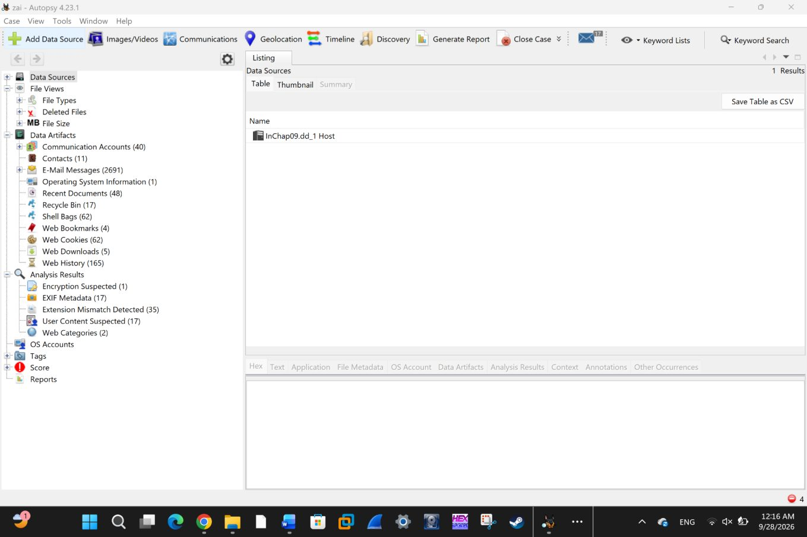 | 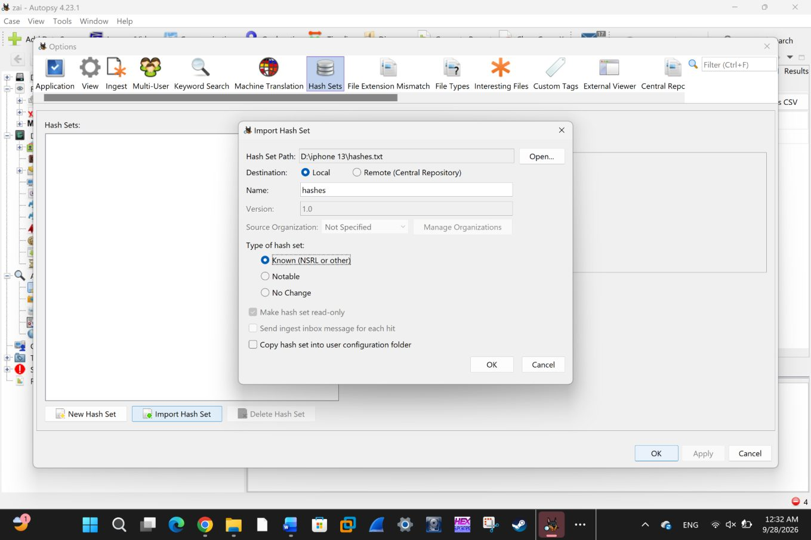 |

### Findings

1. **Project images:** Several workshop and prototype images related to the confidential project were found among the image files.

   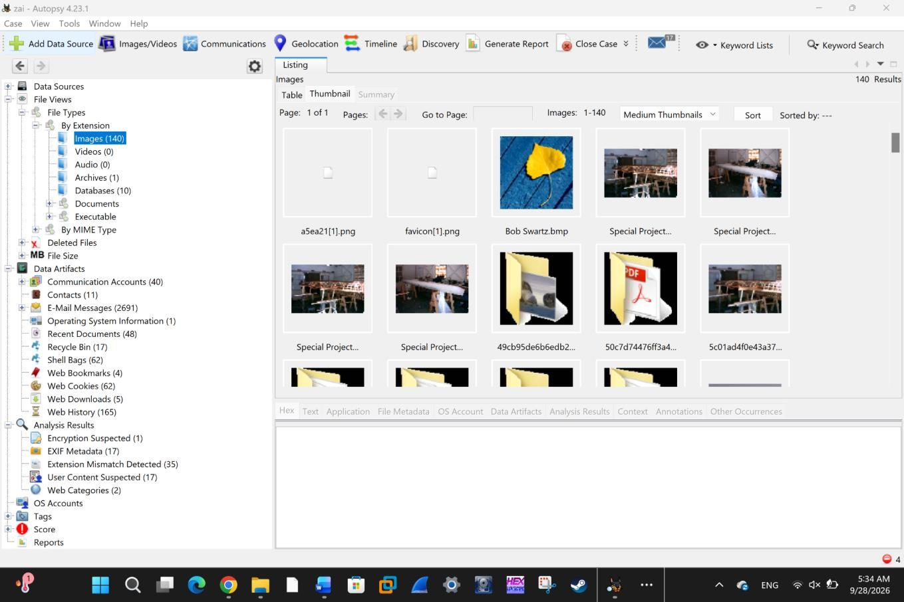

2. **Incriminating e-mail:** A message titled *"You might be interested"* explains that the files are JPEGs altered with a hex editor so the e-mail monitor would not detect them, and that the recipient must restore the JPEG header and rename them with a `.jpg` extension to view them.

   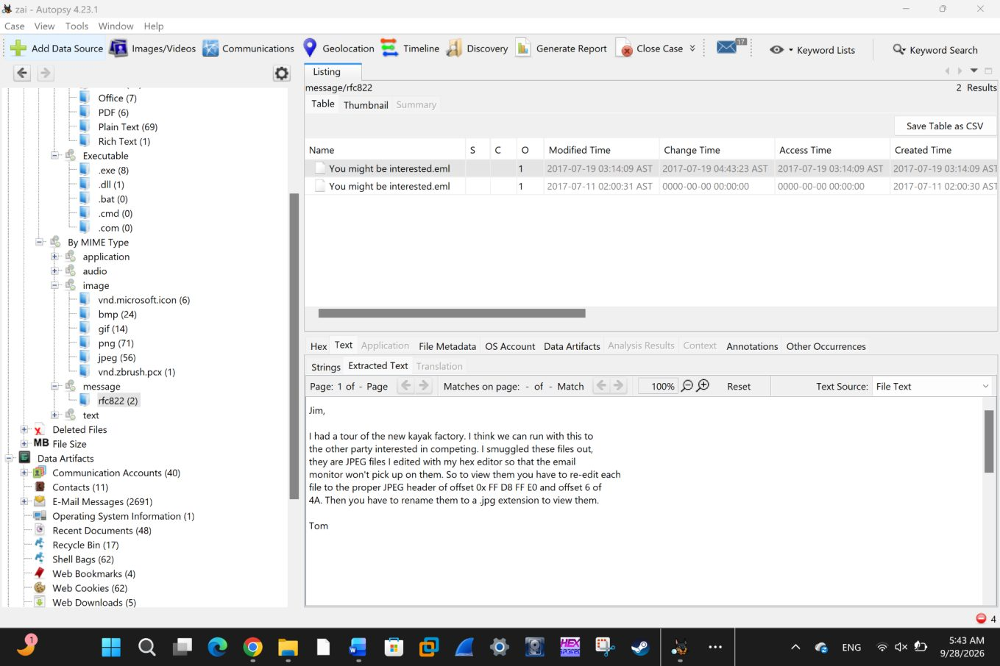

3. **Disguised file:** `gametour3.exe` is identified by Autopsy as `image/jpeg` despite its `.exe` extension, and is flagged as an **extension mismatch**. This confirms the disguise described in the e-mail.

   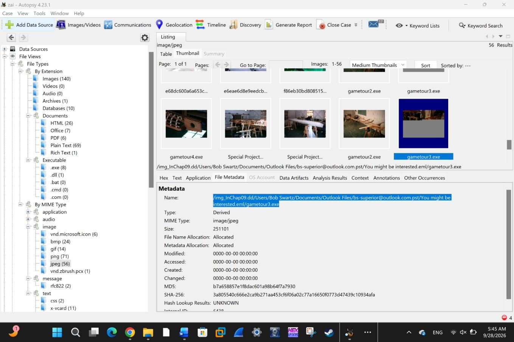

4. **Evidence tagged:** The suspicious files were tagged for inclusion in the case report.

   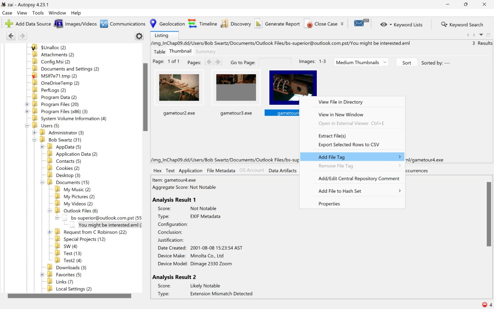

## Key Takeaways
- Hash values are the basis for proving evidence has not changed.
- Bit shifting and rotation are simple ways to hide data, and they are fully reversible by an examiner.
- Known-file hash sets cut down the volume of files that need manual review.
- File signatures, not extensions, reveal a file's true type. Extension-mismatch detection exposed the disguised images.
