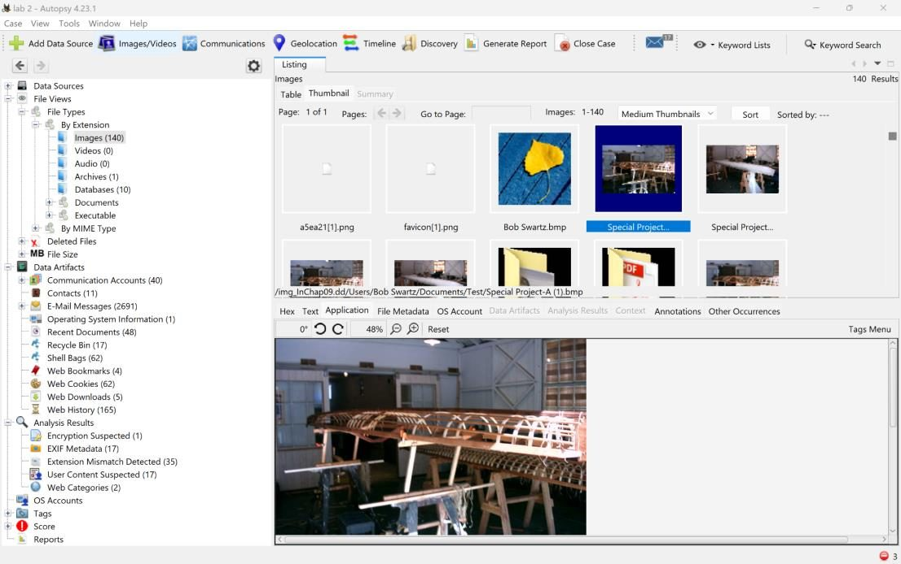
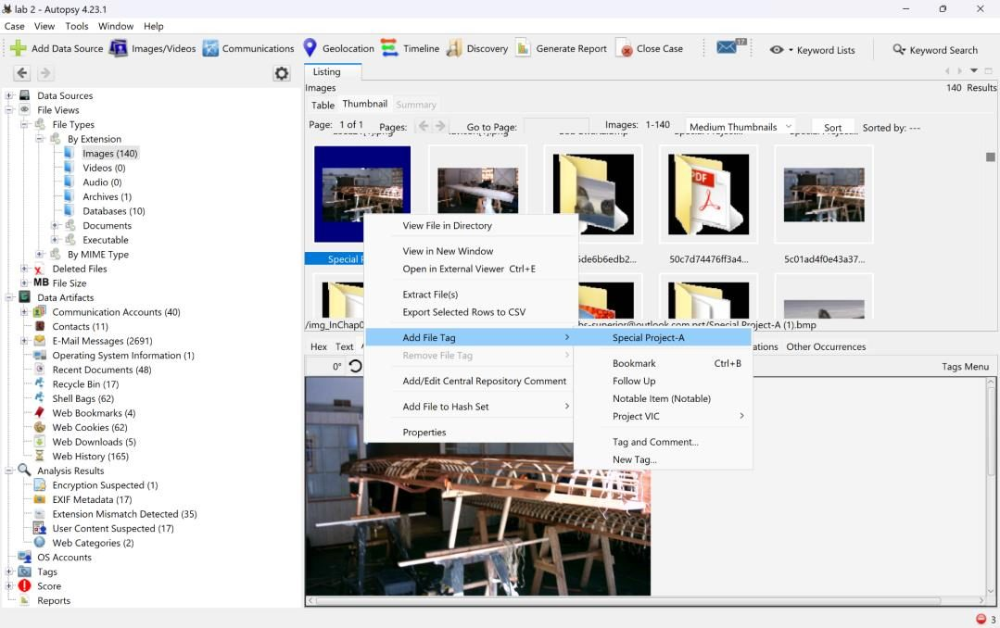
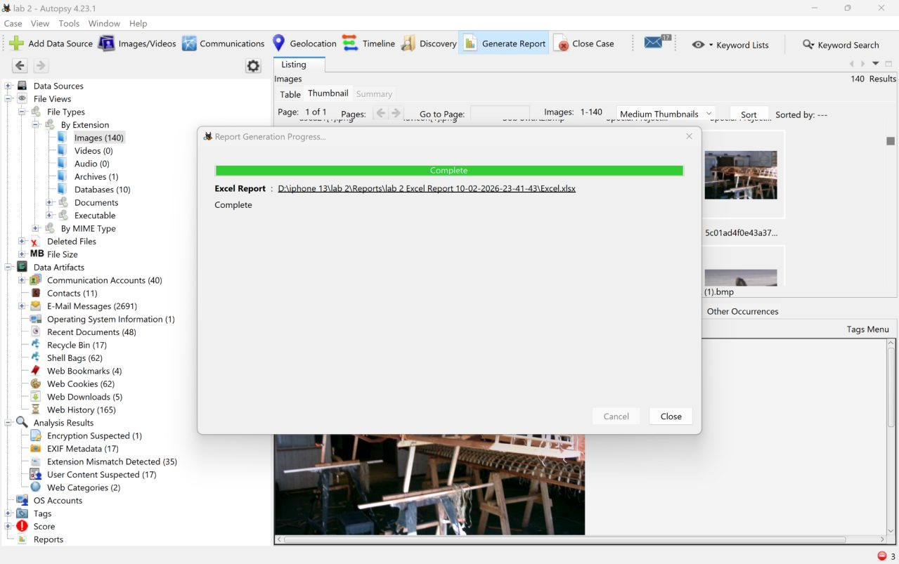
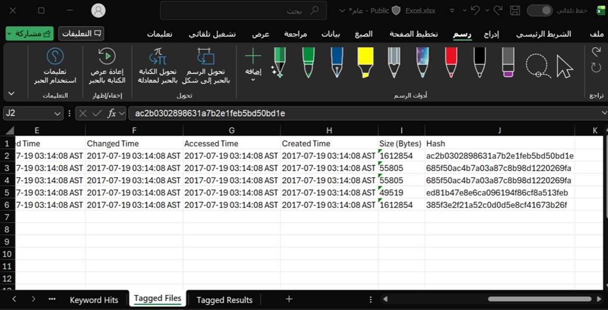
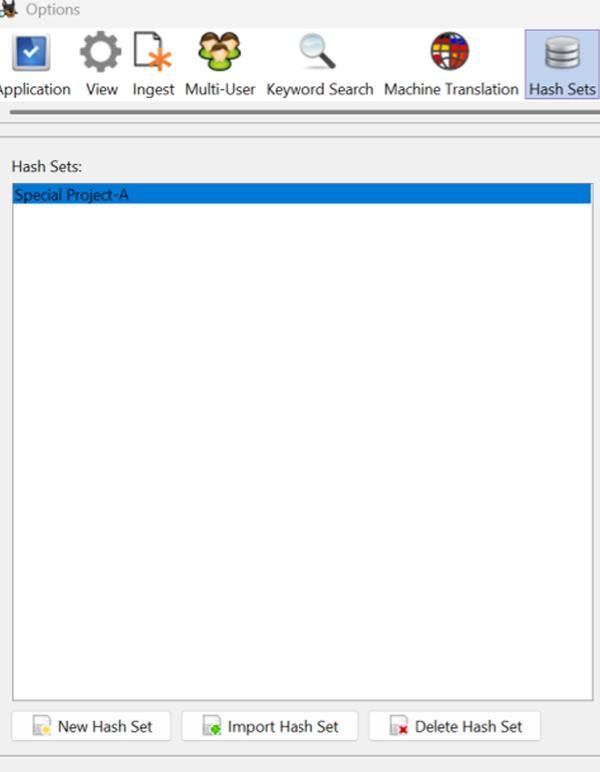
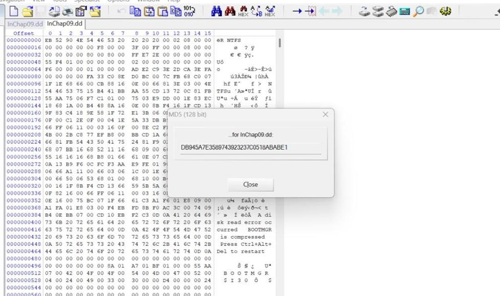
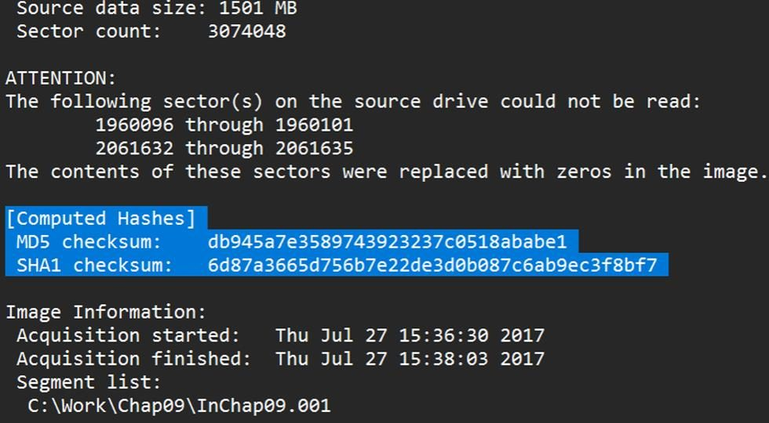

# Lab 02: Hash Sets and Forensic Image Validation

**Course:** CYS 405 Advanced Digital Forensics | **Tools:** Autopsy, WinHex, FTK Imager | **Evidence:** InChap09.dd

## Objective
Find and tag files of interest in Autopsy, build a custom hash set from their MD5 values, and validate the integrity of the forensic image with two independent tools.

## Steps

### 1. Find and Tag the Files
Under **File Views > File Types > Images**, the *Special Project-A* image files were located. A tag named **Special Project-A** was created and applied to each of them.

| Locating the files | Creating the tag |
|---|---|
|  |  |

### 2. Generate a Report and Collect the Hashes
An Excel report of the tagged results was generated, and the MD5 hash of each tagged file was collected from it.

| Report generation | MD5 values in the report |
|---|---|
|  |  |

### 3. Build a Custom Hash Set
A hash set named **Special Project-A** was created in Autopsy from the unique MD5 values. In future cases, any file matching this set is flagged automatically.

### 4. Validate the Forensic Image
The MD5 hash of the full image was calculated in WinHex and compared with the hash FTK Imager recorded at acquisition:

| Tool | MD5 |
|---|---|
| WinHex | `DB945A7E3589743923237C0518ABABE1` |
| FTK Imager (acquisition) | `DB945A7E3589743923237C0518ABABE1` |

The values match, so the image is unchanged since acquisition.

| WinHex hash | FTK Imager acquisition log |
|---|---|
|  |  |

## Key Takeaways
- Custom hash sets turn one investigation's findings into automatic detection for the next.
- Validating an image with two independent tools gives stronger proof of integrity than relying on one.
