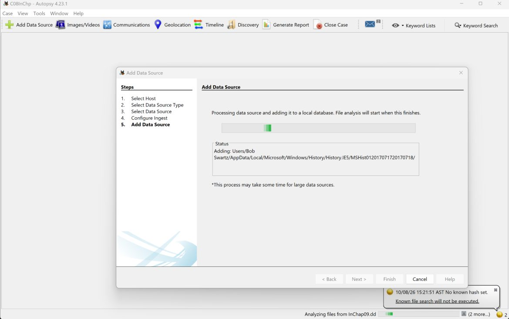
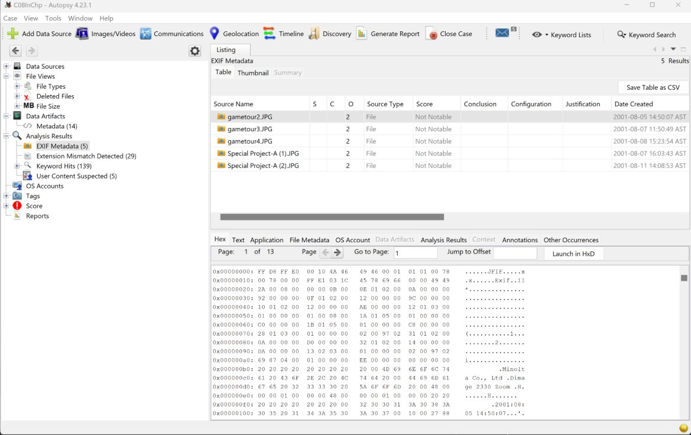
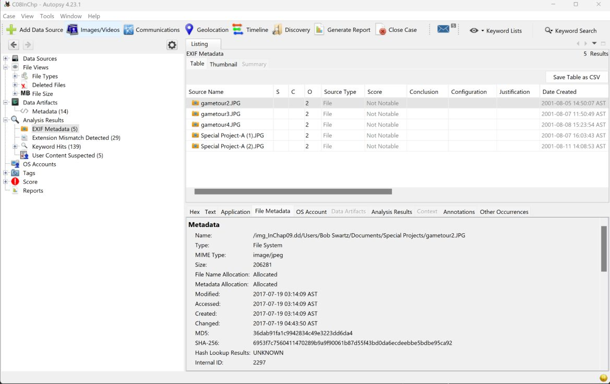
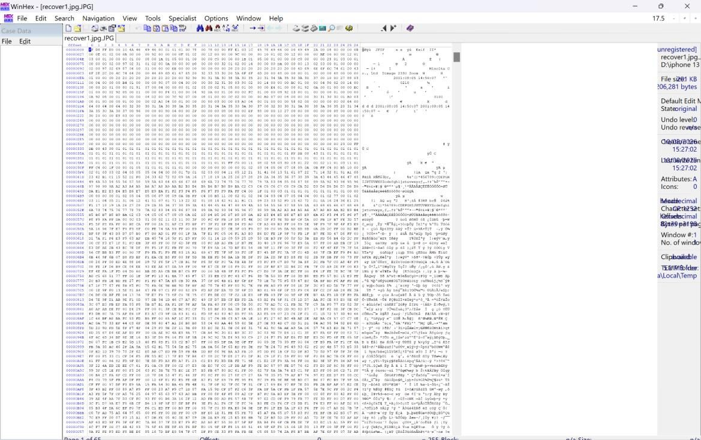
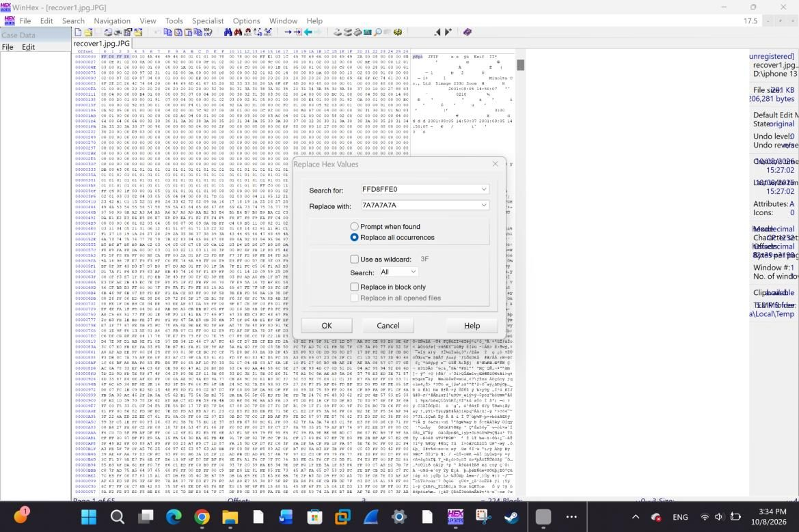
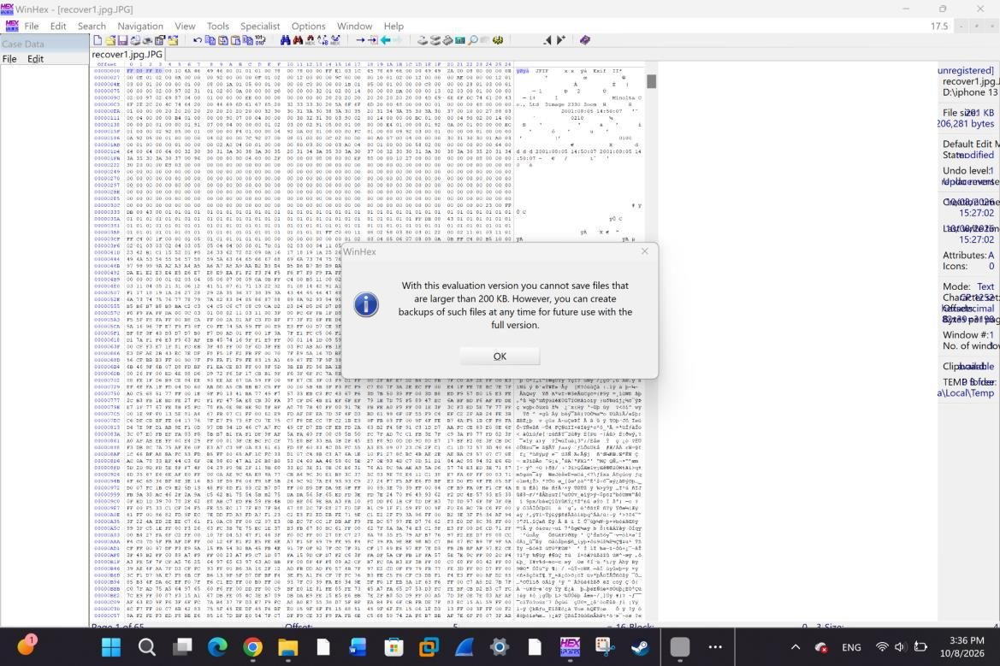

# Lab 03: Digital Photograph Evidence and File Header Recovery

**Course:** CYS 405 Advanced Digital Forensics | **Tools:** Autopsy 4.23.1, WinHex 17.5 | **Evidence:** InChap09.dd

## Objective
Locate and extract a JPEG from a disk image, then damage and repair its file header to understand how examiners recover images whose signatures have been altered.

## Steps

### 1. Process the Evidence
A new Autopsy case was created and the disk image added as a data source.

### 2. Find the Image
**Analysis Results > EXIF Metadata** listed five images. `gametour2.JPG` was selected, and its JPEG header was visible in the hex view.

| EXIF results | JPEG header in hex |
|---|---|
|  |  |

### 3. Check Metadata and Extract
The metadata confirmed the `image/jpeg` MIME type and a size of 206,281 bytes. The file was extracted and opened in WinHex.

### 4. Damage and Repair the Header
| Action | First four bytes |
|---|---|
| Original JPEG signature | `FF D8 FF E0` |
| Damaged | `7A 7A 7A 7A` |
| Restored | `FF D8 FF E0` |

Replacing the signature makes the file unrecognizable as a JPEG. Writing the correct signature back restores it. This is the same technique a suspect would use to hide images, and the same fix an examiner applies to recover them.

| Damaged header | Restored header |
|---|---|
|  |  |

### 5. Saving the Repaired File
WinHex's evaluation version cannot save files larger than 200 KB. The image was 206,281 bytes, so the repaired copy could not be saved and opened to confirm the recovery. The header itself was fully restored in the editor.

## Key Takeaways
- File type is defined by its signature bytes, not its name or extension.
- A corrupted header can hide a valid image, and restoring the known signature recovers it.
- Tool limitations, like trial-version size caps, need to be known before relying on a tool in an investigation.
