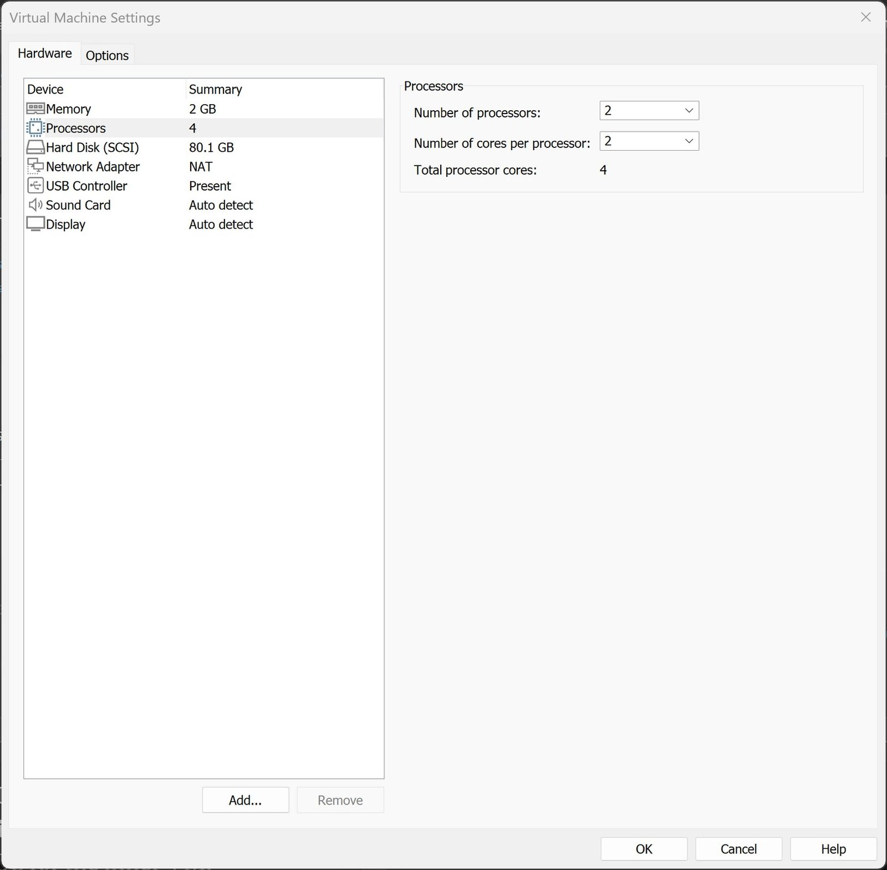
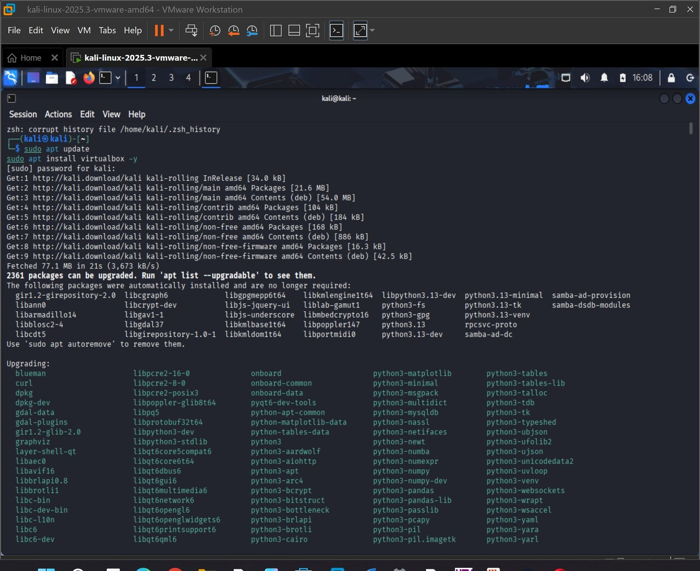
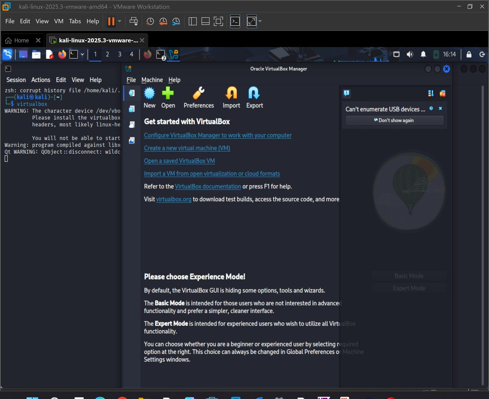
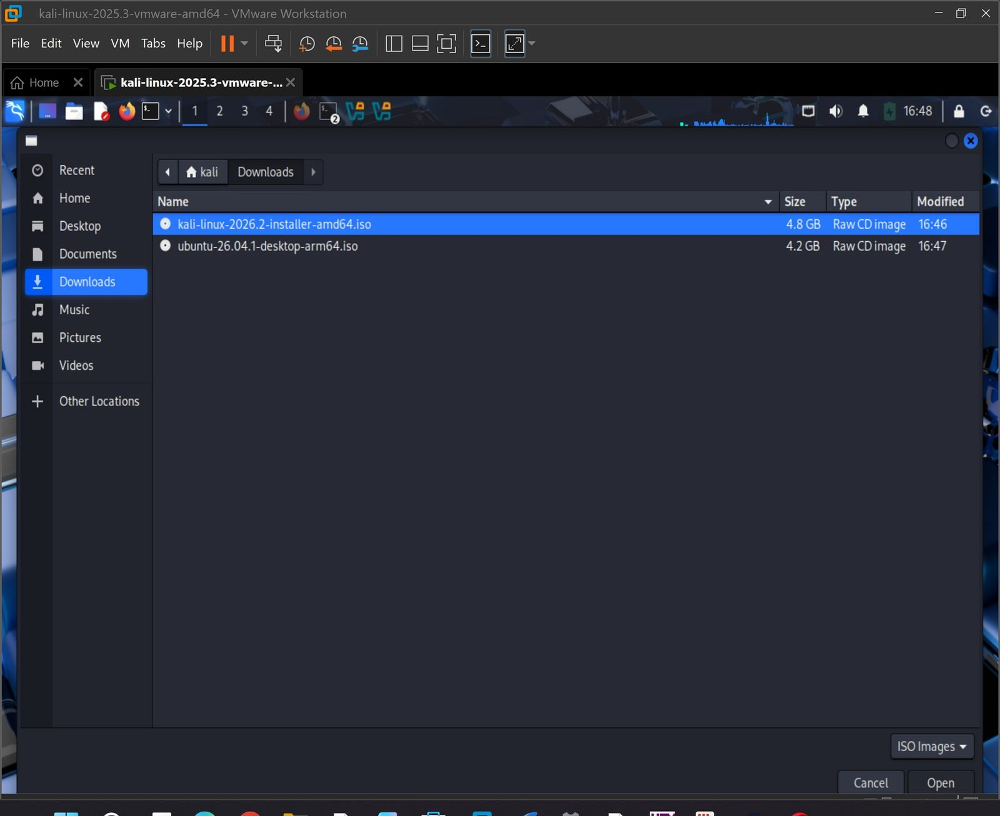
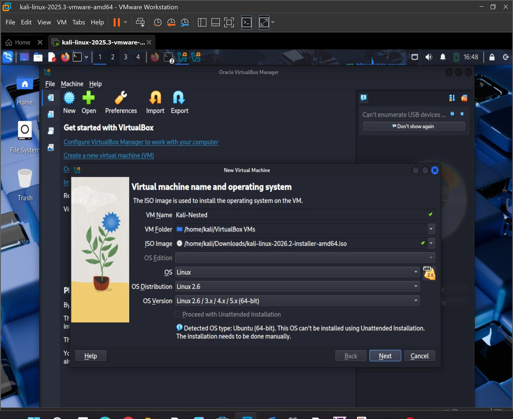
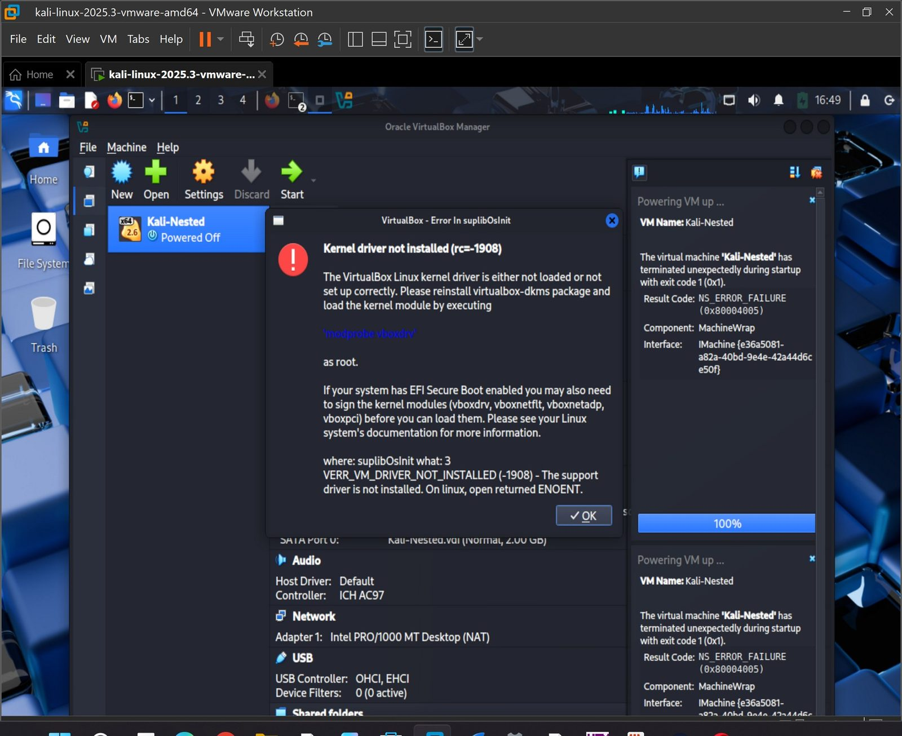

# Lab 04: Nested Virtual Machine

**Course:** CYS 405 Advanced Digital Forensics | **Tools:** VMware Workstation, VirtualBox, Kali Linux

## Objective
Build a virtual machine inside another virtual machine and observe the files it creates. This matters in forensics because suspects can hide activity inside nested VMs. The outer VM was Kali Linux in VMware Workstation, with VirtualBox installed inside it to host the inner VM.

## Steps

### 1. Enable Nested Virtualization
In the Kali VM's VMware settings, **Virtualize Intel VT-x/EPT or AMD-V/RVI** was enabled under Processors so a hypervisor can run inside the guest.



### 2. Install VirtualBox in Kali

```bash
sudo apt update
sudo apt install virtualbox
```

| Installation | VirtualBox Manager |
|---|---|
|  |  |

### 3. Create the Nested VM
A guest ISO was selected and a nested VM named **Kali-Nested** was created with the ISO attached.

| ISO selection | New VM wizard |
|---|---|
|  |  |

## Result and Troubleshooting
Starting the nested VM failed with:

```
Kernel driver not installed (rc=-1908)
VERR_VM_DRIVER_NOT_INSTALLED
```



**Cause:** the VirtualBox kernel module (`vboxdrv`) was not loaded for the running Kali kernel after installation, so VirtualBox could not access the virtualization driver and the guest terminated at startup.

**Outcome:** The outer environment was fully prepared (nested virtualization enabled, VirtualBox installed, nested VM created), but the nested VM did not boot in this environment.

**Next steps to resolve:** install the kernel headers for the running kernel and the `virtualbox-dkms` package so the module is built, then load it with `modprobe vboxdrv`. If Secure Boot is enabled, the module must also be signed.

## Key Takeaways
- Nested virtualization depends on both hypervisor settings (VT-x pass-through) and correctly built kernel modules in the guest.
- Hypervisor driver errors are a common failure point, and reading the error code points directly to the missing component.
